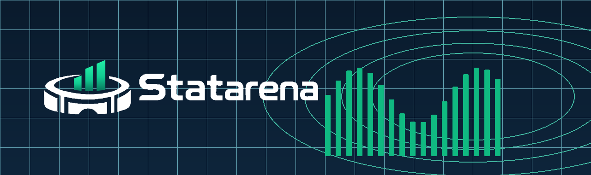

# STATARENA



STATARENA est un projet de recherche consacré à la création d’un classement personnel du Ballon d’Or à partir des performances individuelles, match par match.

L’approche vise à comparer attaquants, milieux, défenseurs et gardiens en tenant compte de leur rôle, de leur temps de jeu et du niveau des équipes rencontrées.

## Approche

La méthode proposée évalue les performances par rapport à une référence adaptée à chaque rôle. Elle combine finition, création, progression, défense et conservation du ballon, avec une évaluation spécifique aux gardiens.

Les contributions sont ensuite agrégées sur la saison pour associer volume et niveau moyen de performance. Le classement cherche ainsi à mesurer l’excellence relative dans chaque rôle.

Les formules, pondérations et limites sont détaillées dans la [documentation mathématique](docs/METHODE_CLASSEMENT_BALLON_D_OR.md).

## Explorer les données

[Ouvrir le dashboard STATARENA](https://statarena-analytics.vercel.app).

Les données de football sont centralisées dans Neon : PostgreSQL indexe les ressources et le stockage objet privé conserve les fichiers. Le backend sert les pages, les observations et les images ; le site n’appelle pas directement Pitch API. Le format des tables et des vues calculées est conservé dans Neon.

Le [dashboard STATARENA](docs/DASHBOARD.md) permet de parcourir les compétitions et les clubs, comparer les joueurs et explorer les matchs. Les valeurs absentes restent distinctes des zéros. Le classement STATARENA reste à calibrer et à valider.

Pour développer, utiliser Node.js 26 et Bun 1.4.4. Configurer les identifiants Neon en lecture seule à partir de `dashboard/.env.example`, puis :

```sh
cd dashboard
bun install
bun run build
bun start
```

Ouvrir http://127.0.0.1:3000/. `bun run verify` lance les vérifications E2E du serveur de production et enregistre les preuves. Aucun dossier local `data` ni clé Pitch n’est nécessaire au site.

Les deux workflows **Daily Sync** et **Historical Backfill** ingèrent les données directement dans Neon. La clé Pitch est conservée dans les secrets GitHub Actions. L’[architecture Neon](docs/NEON_STORAGE.md) décrit les connexions, le cache, la reprise et les limites de couverture.

Les sources complémentaires conservent leur attribution et leurs conditions d’usage, notamment [open-matchday](https://github.com/oladeeayo/open-matchday). Les refus des sources restent enregistrés ; une collecte bornée ne signifie pas que toute l’histoire mondiale est déjà disponible.

## Licence

[MIT](LICENSE). Les données de fournisseurs tiers restent soumises à leurs propres conditions d’utilisation.
