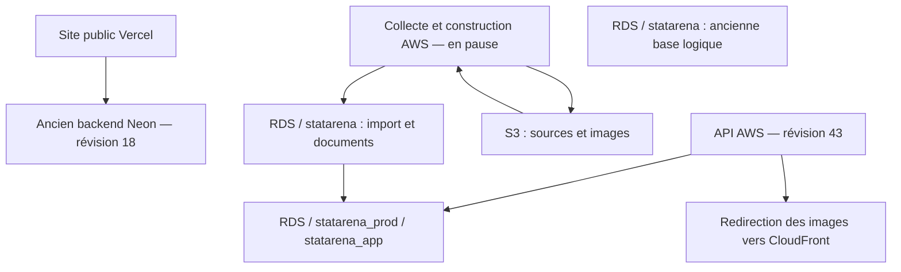
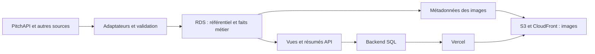

# StatArena — audit de l’architecture des données

**4 novembre 2026, Europe/Paris. Audit en lecture seule ; implémentation en pause.**

La cible ci-dessous intègre la clarification utilisateur : nouvelles collectes directement dans RDS, S3 pour les médias uniquement. Le [plan détaillé à valider](architecture/orion-plan-20261104/PLAN.md) et son lecteur visuel précisent le schéma proposé et le nettoyage final ; les constats chiffrés de cet audit restent datés de leur relevé.

## Verdict

L’alerte est fondée : l’architecture actuelle conserve beaucoup de l’ancien fonctionnement par fichiers et lui ajoute plusieurs représentations SQL. Elle ne constitue pas encore une base métier unifiée et complètement alimentée. En revanche, les tables `players`, `teams` et `matches` existent réellement : elles se trouvent dans `statarena_prod.statarena_app`, un schéma masqué par le filtre de la connexion DataGrip production.

Il y a **une instance RDS, deux bases applicatives logiques**, une ancienne production encore sur Neon et une API AWS partiellement alimentée. S3 contient les originaux et images ; le pipeline d’ingestion reste orienté fichiers. Mettre tous ces fichiers dans des colonnes SQL ne suffit pas à construire le modèle métier attendu.

Je suis responsable d’une partie de cette complexité : mes migrations `003` à `011` ont ajouté les modèles de lecture et de compatibilité API. Elles ont permis des lectures structurées depuis SQL, mais elles n’ont pas achevé la normalisation du domaine ni sa couverture. Il serait incorrect d’attribuer tout le problème au transfert Neon → AWS.

## Périmètre et méthode

Les relevés du 4 novembre couvrent 12:19–13:10 Paris : catalogues et contraintes PostgreSQL, comptages exacts sélectionnés, allocation physique, inventaire S3 complet par métadonnées, configuration Lambda/Vercel/CloudFront, filtres DataGrip, code des lecteurs et producteurs, contrôles de références et état des workflows.

Les connexions SQL utilisent TLS vérifié, des transactions `REPEATABLE READ READ ONLY` et une limite de 20 secondes par requête. Aucun contenu de réponse fournisseur, profil nominatif ou secret n’est exporté dans les preuves. Aucun objet métier S3 n’est téléchargé : les sondes publiques sont des requêtes HEAD. Les fichiers et scripts d’audit sont locaux. Les comptages proviennent de plusieurs instantanés horodatés, pas d’un gel distribué de toutes les sources.

La pause a désactivé les trois workflows backend de collecte/construction et annulé le constructeur actif `41813449529`. Son nettoyage final est réussi. Les processus distincts du transfert initial appartenant à l’autre Codex n’ont pas été modifiés. Aucun changement de schéma, effacement, redéploiement ou nouveau backfill n’a été effectué pour cet audit.

## 1. Pourquoi voit-on deux bases ?

| Élément | État constaté | Utilisation vérifiée |
|---|---|---|
| Instance RDS `statarena-postgres` | PostgreSQL 18.6, `db.t4g.micro`, 64 Gio, Ohio, disponible | Un seul serveur RDS pour ces deux bases |
| Base `statarena` | **594 482 879 octets**, soit 0,59 Go ; 58 922 fixtures, 306 067 objets catalogués | Copie d’import plus ancienne ; aucun lecteur applicatif AWS actuel identifié dans les composants inspectés |
| Base `statarena_prod` | **13 707 237 055 octets**, soit 13,71 Go ; 66 205 fixtures, 306 110 objets catalogués | Cible vérifiée de Lambda et de la configuration d’ingestion AWS |
| Bases `postgres`, `rdsadmin` | Bases système présentes | Pas deux autres environnements applicatifs |

Le champ RDS `DBName=statarena` décrit la base créée à l’initialisation. Il ne dit pas quelle base utilise le site aujourd’hui. C’est la sémantique documentée par [AWS pour RDS PostgreSQL](https://docs.aws.amazon.com/sdk-for-kotlin/api/latest/rds/aws.sdk.kotlin.services.rds.model/-create-db-instance-request/-builder/db-name.html).

**Ce que je peux conclure :** les deux bases applicatives ne sont pas synchronisées et n’ont plus le même contenu ni les mêmes schémas. Les inventaires diffèrent de 7 283 fixtures et 43 objets catalogués. `statarena` n’est pas un environnement de développement identifié par la configuration inspectée ; le nom seul ne permet pas de lui attribuer ce rôle.

**Ce qui reste inconnu :** la raison historique exacte de la seconde création et l’existence éventuelle de consommateurs externes non inspectés. Une seule photographie de `pg_stat_activity` ne peut pas démontrer l’absence de tout consommateur. Aucun rapprochement exhaustif des clés et contenus entre bases n’a été réalisé ; leur suppression ou fusion n’est donc pas justifiée par cet audit.

Deux bases logiques sur la même instance ne signifient pas deux instances RDS facturées. Supprimer la petite base ne libérerait au mieux qu’environ 0,59 Go de contenu et ne réduirait pas automatiquement le volume provisionné de 64 Gio.

## 2. Où sont les joueurs, clubs et matchs ?

Une base PostgreSQL contient des schémas, qui contiennent les tables. Ici, `statarena` est à la fois le nom d’une base et d’un schéma, ce qui ajoute à la confusion. [Documentation PostgreSQL sur les schémas](https://www.postgresql.org/docs/current/ddl-schemas.html).

Dans **la base `statarena_prod`, schéma `statarena_app`** :

| Table | Nombre exact de lignes | Ce qu’elle représente actuellement |
|---|---:|---|
| `players` | **14 203** | Identités de lecture, correspondant à 14 202 identifiants joueur fournisseur distincts |
| `teams` | **575** | Équipes ; c’est ici que se trouve le concept correspondant aux clubs |
| `matches` | **3 273** | Matchs enrichis, tous au statut `finished` au relevé |
| `fixtures` | **7 813** | Calendrier séparé des matchs enrichis |
| `competitions` | **38** | Compétitions représentées dans cette publication partielle |
| `competition_seasons` | **38** | Une seule saison représentée dans les partitions publiées |
| `appearances` | **125 456** | Participations et statistiques de joueurs par match |
| `shots` | **90 076** | Tirs du modèle de lecture principal |
| `team_statistics` | **119 853** | Statistiques d’équipes du modèle principal |

La connexion DataGrip « StatArena prod — AWS RDS (Ohio) » limite actuellement son introspection au schéma `statarena`. Elle ne montre donc pas `statarena_app`. La base `statarena` ne contient, elle, aucun schéma `statarena_app`. Aucun filtre DataGrip n’a été modifié pendant cet audit.

Ces tables ne constituent pas encore un référentiel complet :

- `players` n’a que **quatre colonnes** : `id`, `player_id`, `name`, `image_url`. Les profils complets ne sont pas représentés par cette table ; aucun reçu `worker_inputs` de type `profile` n’est présent.
- L’identifiant interne joueur peut dépendre du nom et de l’image de son contexte source. Il existe une version supplémentaire pour un identifiant fournisseur. Ce n’est pas une duplication massive mesurée ; c’est un choix d’identité de projection à remplacer si cette table devient le référentiel canonique.
- `matches` et `fixtures` n’imposent pas de clés étrangères vers les équipes et compétitions. `appearances` impose bien ses références vers `players` et `matches`.
- De nombreuses autres tables conservent l’arbre d’une réponse fournisseur, avec `resource_id`, `record_no`, `parent_no`, positions et indicateurs de champs absents. Cela préserve le contrat API, mais ne remplace pas les relations métier entre joueurs, équipes et rencontres.

## 3. Pourquoi autant de tables ?

Le schéma `statarena_app` contient **161 tables et 5 vues**. Il n’y a aucune colonne `json`, `jsonb` ou `bytea` dans cette couche au relevé. Le lecteur AWS dispose donc bien de représentations typées ; l’absence de JSONB ne garantit toutefois pas un modèle métier cohérent.

| Origine des tables | Tables | Allocation physique, index et TOAST compris |
|---|---:|---:|
| Modèle principal `003` | 24 | 181,55 Mo |
| Détails de matchs `004` | 41 | 902,06 Mo |
| Modèles complémentaires `005` | 19 | 3,38 Mo |
| Catalogues `006` | 63 | 13,39 Mo |
| Métriques compactées `009` | 10 | 120,77 Mo |
| Reçus de sources et numéros de maillot `010`–`011` | 2 | 10,55 Mo |
| Métadonnées du worker | 2 | 0,12 Mo |

Les 63 tables de catalogues occupent peu de place ; leur coût principal est la complexité du modèle. Les tables de détails occupent davantage d’espace et recouvrent en partie les mêmes faits que le modèle principal, pour restituer les réponses existantes. Leur suppression sans adapter les lecteurs ferait perdre des comportements et des champs.

**Le problème n’est pas qu’une application de football devrait avoir exactement dix tables.** Événements, tirs, compositions, carrières et statistiques peuvent justifier beaucoup de relations. Le problème est l’absence d’une frontière claire entre référentiel métier, faits statistiques, copies de compatibilité et données techniques d’import.

## 4. Ce qui remplit réellement RDS

| Stockage dans `statarena_prod` | Allocation physique |
|---|---:|
| Schéma d’import `statarena` | **12,459 Go** |
| Schéma de lecture `statarena_app` | **1,232 Go** |
| Schéma hérité `neon_auth` | 0,26 Mo |
| Table `statarena.file_documents` seule | **10,432 Go** |
| Tables `file_payloads` + `file_payload_chunks` | **1,160 Go** |

`file_documents` représente **76,1 % de la taille totale de la base**. Le schéma d’import représente **91,0 % de l’allocation des tables utilisateur**, contre environ 9 % pour la couche de lecture. Ces tailles comprennent les index et le stockage PostgreSQL des grandes valeurs ; elles ne sont pas des tailles de JSON décompressé.

Le comptage exact de `file_documents` est **2 814 256 lignes** :

| Format indexé | Documents |
|---|---:|
| `sqlite-row` | **2 195 735** |
| `json` | 366 924 |
| `jsonl` | 250 748 |
| `csv` | 818 |
| `text` | 31 |

Une ligne de SQLite transformée en document JSONB reste un document importé. Elle n’est pas automatiquement devenue un joueur, un club ou un match dans un modèle relationnel.

Les métadonnées de `file_payloads` confirment aussi la présence, dans RDS, du **dump `_migration/neon-full-initial.dump` de 239 026 879 octets**, de scripts de migration, de copies d’images et de **six ZIP de code**, pour 361 405 octets au total. Le dump est également présent dans S3. Ces ZIP sont minuscules ; leur importance est de montrer que le miroir SQL copie aussi des objets techniques sans rapport avec les faits métier. Aucun lecteur de `file_payloads` ou `file_payload_chunks` n’a été trouvé dans le backend et les scripts versionnés inspectés ; les outils externes du transfert peuvent néanmoins en avoir l’usage.

`neon_auth` contient neuf tables héritées. Les estimations statistiques indiquent des tables presque vides ; je n’ai pas lu de comptes ou sessions. Leur nom ne prouve pas un usage actuel de l’authentification Neon.

## 5. Pourquoi S3 intervient encore

L’inventaire complet du bucket football, **307 pages**, compte **306 124 objets pour 4 890 689 338 octets**, soit 4,89 Go :

| Classe de fichiers, déterminée par extension | Objets | Taille |
|---|---:|---:|
| Images | 37 859 | **401,93 Mo** |
| JSON / JSONL, éventuellement compressés | 263 012 | **2,709 Go** |
| Autres formats, dont archives et fichiers sources | 5 253 | **1,780 Go** |

S3 est un stockage d’objets, adapté notamment aux fichiers et archives ; ce rôle peut coexister avec une base relationnelle. [Documentation Amazon S3](https://docs.aws.amazon.com/AmazonS3/latest/userguide/Welcome.html).

**Chemin d’ingestion actuel :** `neon_store.py` conserve les objets dans S3 et leurs métadonnées dans SQL, avec indexation documentaire SQL optionnelle. Le matérialiseur lit d’abord `current_file_documents`, puis peut relire l’objet S3 si ce document n’est pas disponible. Les tables métier sont construites après cette étape. Le pipeline continue donc à fonctionner autour des fichiers d’origine.

**Chemin de lecture AWS :** Lambda cible `statarena_prod` et les tables typées `statarena_app`. Ses variables ne contiennent ni clés S3 ni clé PitchAPI. Les images sont redirigées vers CloudFront. Ce chemin structuré SQL est réel, mais sa couverture reste partielle.

**Chemin CDN restant :** la fonction CloudFront autorise des images et des JSON immuables dont le chemin contient un hash. Les sondes HEAD constatent :

| Ressource testée | HTTP | Contenu téléchargé |
|---|---:|---:|
| Image avec le bon préfixe `/data/` | **200** | 0 octet |
| JSON immuable sous `data/raw/pitchapi-world/blobs/` | **200** | 0 octet |
| Manifeste mutable `data/raw/index.json` | **403** | 0 octet |
| Dump `_migration/neon-full-initial.dump` | **403** | 0 octet |

Le bucket bloque les accès publics S3 directs et autorise la distribution CloudFront prévue. **Aucune exposition publique du dump n’est démontrée.** L’ouverture des JSON immuables est une compatibilité existante à inventorier avant de pouvoir réduire le CDN aux seuls assets binaires. Ces quatre sondes ne constituent pas un audit exhaustif de sécurité.

Le bon objectif est donc : nouvelles données décodées en mémoire puis écrites directement dans les tables RDS ; images et médias indispensables dans S3 ; anciens originaux gardés seulement pour réconciliation, puis supprimés. Copier systématiquement les archives, images et documents en SQL n’est pas nécessaire pour rendre le backend relationnel.

## 6. Ce que le site utilise réellement

Le nœud « ancienne base logique » désigne la **base** `statarena`, et non le schéma du même nom présent dans `statarena_prod`.

- Le domaine public `statarena-analytics.vercel.app` répond encore `source: Neon`, révision 18. Le déploiement production est `READY`, commit `0aaf316e0aa525c90b3787df623bb5bfcc2936c8`.
- L’API `d317dq37z1tacb.cloudfront.net` répond `source: AWS`, révision 43. Sa connexion pointe explicitement vers `statarena_prod`, rôle `statarena_runtime`.
- L’origine AWS frontend n’est configurée que sur une preview historique ; les variables de production Vercel conservent la connexion Neon.
- Les noms `NEON_DATABASE_URL` et `NEON_STORAGE_*` sont aussi réutilisés comme interface interne du collecteur AWS. Dans ce cas, leurs valeurs ciblent RDS et S3. Un nom `NEON_*` ne prouve donc pas à lui seul une requête vers Neon, mais ce vocabulaire masque la configuration réelle.

La migration de la production publique n’est pas terminée. Un healthcheck 200 de l’API AWS ne suffit pas à valider la couverture des sources ou les pages les plus lourdes.

## 7. Couverture et cohérence mesurées

| Contrôle | Résultat | Interprétation |
|---|---:|---|
| Fixtures source / matchs enrichis servis | 66 205 / 3 273 | Univers différents ; le modèle principal ne couvre pas encore l’ensemble des sources |
| Fixtures source terminées | 57 064 | À rapprocher par périmètre et identifiant avant tout taux d’acceptation |
| Partitions publiées | 38 compétitions, 1 saison | Couverture partielle, pas historique complet |
| Participations dont saison/ligue diffère du match parent | **0** | Contrôle de cohérence satisfait pour les lignes présentes |
| Références renseignées d’équipes/compétitions non résolues dans les matchs | **0 sur 3 273** | Les identifiants renseignés se résolvent, même si les FK manquent au schéma |
| Références renseignées d’équipes/joueurs/matchs non résolues dans les participations | **0 sur 125 456** | Aucune référence orpheline dans ce périmètre ; aucun identifiant de match NULL |
| Références équipes du calendrier absentes de `teams` | **108 domicile, 108 extérieur** | Les deux groupes peuvent se recouvrir ; ce n’est pas un compte de 216 rencontres distinctes |
| Statuts source/calendrier différents | **15** | 11 `finished` → `not_started` ; 4 `not_started` → `postponed` |
| Jobs historiques d’import `pending` | **467 288** | Ne prouve pas que 467 288 requêtes utiles restent à télécharger ; queue à classifier |

Autre distinction nécessaire : les familles de ressources concernent 7 322 identifiants de rencontre, dont 3 273 ont un `matches` enrichi. Pour les **4 049 autres**, les statuts sont : 4 037 rencontres à venir des deux côtés, 1 reportée des deux côtés et 11 terminées côté source mais encore à venir côté lecture. On ne peut donc pas présenter ces 4 049 identifiants comme autant de matchs perdus.

Le marqueur SQL du worker indique encore `running`, `remaining=36 705`, dernière mise à jour à 11:20:46 Paris, alors que le run GitHub a été annulé à 12:20:22 Paris et qu’aucun bail de publication n’est détenu au relevé. C’est un état opérationnel périmé, pas la preuve d’un travail actif. Il est resté inchangé pour préserver la lecture seule.

Enfin, le lecteur AWS actuellement déployé a un défaut connu : une page dense de 100 matchs peut répondre **503 / SQL 57014** sous sa limite SQL de 8 secondes. Un correctif local existe et une requête candidate a terminé en 4 888,575 ms, mais il reste **non publié et non déployé** pendant la pause. Ce résultat isolé n’établit pas un nouveau p95 ni la correction du service public.

## 8. Architecture cible proposée

**Une base applicative de référence dans RDS**, avec des schémas aux rôles explicites. La base `statarena_prod` est la candidate naturelle puisqu’elle contient le travail récent et les consommateurs AWS identifiés. Son nom n’est pas un enjeu prioritaire ; aucune nouvelle base ni copie supplémentaire n’est nécessaire pour décider du modèle.

| Domaine | Relations attendues | Règles principales |
|---|---|---|
| Identités | `players`, `teams`, `competitions`, `seasons` | Identifiants internes stables ; correspondances fournisseur explicites et uniques dans leur périmètre |
| Profils et historique | Profils joueur, affiliations joueur/équipe, entraîneurs, stades selon les besoins | Les changements d’image ou de nom ne créent pas une nouvelle personne |
| Compétitions | `competition_seasons`, engagements d’équipes | Références étrangères vers saisons, compétitions et équipes |
| Rencontres | `matches` | Une identité pour toutes les rencontres, à venir ou terminées ; statut et date mis à jour sur cette identité |
| Faits | Participations, compositions, événements, tirs, statistiques joueur/équipe | Références aux rencontres, joueurs et équipes ; unités et périodes définies |
| Ingestion technique | Sources, identifiants fournisseur, runs, erreurs, curseurs, reçus | Provenance et reprise sans imposer la structure des réponses fournisseur au domaine |
| Lecture / compatibilité | Résumés, projections ou vues nécessaires aux API | Dérivées des faits métier, reconstruisibles, versionnées si mises en cache |
| Médias | Métadonnées/licences/références dans SQL ; binaires indispensables dans S3 | Aucun nouveau JSON de données, ni document brut en SQL ; anciennes sources retirées après réconciliation |

`teams` doit distinguer clubs et sélections ; une vue `clubs` est possible si ce nom facilite l’usage. `matches` peut être nommé `games`, mais le changement de vocabulaire ne remplace pas les identités, contraintes et règles de mise à jour.

Le pipeline cible normalise la réponse en mémoire et met à jour les entités de manière transactionnelle, sans fichier de données intermédiaire. Les historiques et instantanés SQL conservent les faits nécessaires aux recalculs définis. Seuls les fichiers historiques déjà présents restent provisoirement pour réconciliation et retour arrière, puis sont supprimés de RDS et S3. Après leur purge, leurs octets et un rejeu arbitraire des parseurs ne seront plus disponibles ; le plan détaillé explicite cette limite.

**UX :** des calendriers, joueurs et comparaisons cohérents à travers les écrans. **DX :** un modèle principal compréhensible et des adaptateurs séparés. **AX :** des clés, contraintes, états de collecte et preuves découvrables sans reconstruire des arbres de fichiers. Le coût est un travail réel de correspondance et de compatibilité API ; supprimer immédiatement les projections compromettrait les contrats existants.

## 9. Ordre de remise en état, sans exécution autorisée par ce rapport

1. **Fixer le contrat métier** : entités, identités fournisseur, statuts, périodes statistiques, champs affichés et données historiques à conserver. Documenter la source de vérité de chaque fait.
2. **Établir la matrice de rapprochement** : pour chaque famille source, compter clés attendues, normalisées, rejetées et non traitées, avec raisons. Classifier aussi les 467 288 jobs hérités.
3. **Normaliser un périmètre représentatif complet** : compétition, saison, rencontres terminées et à venir, fiches joueur/équipe et statistiques lourdes. Conserver les originaux et les lecteurs existants pendant cette validation.
4. **Vérifier les workflows entiers** : collecte → normalisation → publication → API → écrans desktop/mobile, y compris mise à jour d’un match et changement de métadonnées sous cache. Exiger des preuves rejouables et mesurer les latences ainsi que le volume SQL sur le même jeu.
5. **Étendre puis basculer la production** après rapprochement complet. Ensuite seulement décider du retrait de la petite base, des documents/bytes techniques en RDS, de l’ancienne compatibilité CDN structurée et de Neon.

Aucun gain de latence ou coût futur n’est annoncé : cet audit n’a pas modifié le service. Les 10,43 Go de documents ne constituent pas une économie immédiatement réalisable sans rapprochement des données, conservation des sources et traitement du stockage provisionné.

## Preuves et limites

Les preuves sont dans [le dossier d’audit](verification/aws-architecture-audit-20261104/README.md). L’inventaire [tables.csv](verification/aws-architecture-audit-20261104/tables.csv) distingue les estimations de lignes des comptages exacts enregistrés dans [databases.json](verification/aws-architecture-audit-20261104/databases.json).

Les premiers essais d’inventaire ont rencontré une permission sur la base système `rdsadmin`, une réponse vide de l’API S3 versioning et deux erreurs dans des requêtes diagnostiques. Ces erreurs de méthode sont conservées ; les inventaires complets et les requêtes corrigées sont disponibles. Un premier HEAD d’image sans le préfixe `/data/` avait aussi renvoyé 403 ; la sonde corrigée renvoie 200.

Cet audit n’est ni un rapprochement de tous les corps source, ni une validation fonctionnelle exhaustive, ni un audit de sécurité complet. Il établit la topologie, les consommateurs inspectés, les volumes, la structure des tables et plusieurs défauts de couverture/cohérence. **Aucune perte de données globale n’est démontrée ; aucune complétude globale n’est démontrée non plus.**

Nom de commit suggéré : `docs: audit StatArena databases, domain model and S3 usage`.
