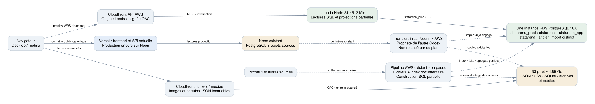
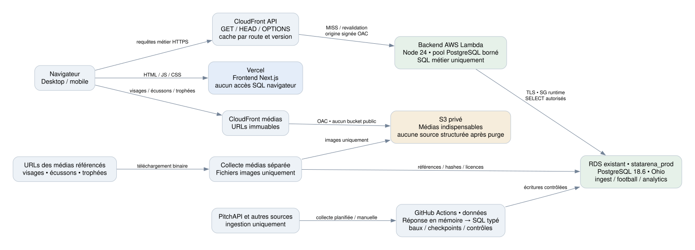

# StatArena — plan de BDD et d’architecture à valider

**4 novembre 2026 — proposition, aucune réorganisation appliquée.**

La mission complète est reprise. Cette première livraison se limite au modèle visuel, au dictionnaire, aux correspondances et au plan d’exécution. **La création/modification du schéma, la transformation des données, leur reconstruction et leur suppression attendent la validation explicite de cette proposition.** La reconnexion AWS autorisée ne vaut pas validation du schéma.

## 1. Décision proposée

Conserver **une base applicative de référence sur le RDS existant**, `statarena_prod`, organisée autour des trois schémas du JSON :

| Schéma | Rôle final |
|---|---|
| `ingest` | Fournisseurs, correspondances publiques, collecte/reprise, provenance sans payload, états de champ, instantanés SQL, contrôles et nettoyage |
| `football` | Identités stables, compétitions/éditions, rencontres, participants, faits détaillés, classements, enrichissements et leurs historiques SQL typés |
| `analytics` | Résumés et agrégats de lecture cohérents, publication/versionnement, recherche ; réserve de modèles Orion clairement séparée |

**Les 84 tables du JSON restent le socle.** La proposition complète comporte **161 tables / 1 971 colonnes / 368 FK décrites** : les 84 tables initiales adaptées, 23 ajouts ciblés et 54 historiques typés. Parmi elles, **9 tables de modèles restent une réserve documentaire** : aucune nouvelle formule Orion n’est autorisée par ce plan. Le périmètre métier/ingestion/lecture à terminer couvre les 152 autres tables, dont les historiques. Ce nombre désigne une proposition physique ; il ne signifie pas 161 entités métier indépendantes.

Les diagrammes complets sont répartis en **22 domaines/planches**, avec toutes les colonnes, leurs types, PK/FK et les références externes. Les tables grises abrégées sont des rappels d’une table représentée intégralement dans son propre domaine. `!` signifie NOT NULL. Les flèches vont de la FK à la clé référencée.

Le [lecteur visuel](index.html) rassemble architecture, diagrammes, dictionnaire, différences et correspondances. Le [dictionnaire complet](DICTIONNAIRE.md) et le [JSON proposé](target-schema.proposed.json) constituent les descriptions détaillées. Le [JSON original](inputs/Orion_schema_bdd.original.json) et le [texte GPT Pro](inputs/GPT_Pro_audit.original.txt) sont conservés **à l’identique** comme documents de conception, séparés des données métier à nettoyer.

## 2. État des lieux vérifié

Les inventaires SQL sont datés de **14:42–14:47 Paris**, avec un relevé d’infrastructure renouvelé après reconnexion. Les deux moteurs interrogés répondent **PostgreSQL 18.6**. Aucune mise à niveau n’est proposée ou effectuée.

| Élément | Constat actuel | Conséquence |
|---|---|---|
| RDS | Une instance, Ohio, `db.t4g.micro`, 64 Gio gp3, chiffrée, disponible | Réutiliser cette instance ; aucune deuxième instance/base cible à créer |
| `statarena` | 0,594 Go, import ancien, aucun `statarena_app` | Comparaison des clés/consommateurs avant retrait ; ne pas l’appeler « dev » sans preuve |
| `statarena_prod` | 13,711 Go, 161 tables et 5 vues dans `statarena_app` | Base AWS actuellement ciblée par Lambda et l’ingestion |
| Couche métier AWS | 14 203 joueurs de lecture, 575 équipes, 3 273 matchs enrichis, 7 813 fixtures, 125 456 performances | Modèle et couverture partiels ; les performances ne prouvent pas toutes une participation |
| Sources AWS | 66 205 fixtures, 306 110 objets catalogués, 415 426 ressources, 1 880 projections | Conserver comme point de départ de normalisation, pas comme preuve de complétude |
| Sources Neon | 66 205 fixtures, 313 912 objets catalogués, 421 386 ressources, 1 935 projections | Écarts nets : 7 802 objets, 5 960 ressources, 55 projections à rapprocher par clés/versions |
| Périmètre calendrier | 77 compétitions et 234 couples compétition–saison dans les deux inventaires récents | L’égalité des comptes ne démontre pas l’égalité des lignes ou contenus |
| Écarts de projections | Neon : 1 125 portraits et 65 palmarès ; AWS : 1 104 et 31 | 21 portraits et 34 palmarès d’écart net ; transfert physique toujours réservé à l’autre Codex |
| Import documentaire | 2 814 256 `file_documents`, dont 2 195 735 lignes SQLite converties ; 10,432 Go | La réorganisation doit extraire les faits détaillés, puis retirer ces documents |
| Payloads binaires SQL | `file_payloads` + chunks : 1,160 Go | Retirer copies d’images, archives, dump et ZIP de ce miroir après vérification |
| S3, inventaire complet 15:51–15:58 Paris | 306 124 objets / 4,891 Go, dont 401,93 Mo d’images | Baseline complète conservée ; refaire un inventaire exact/versionné au nettoyage, pas une projection de gain |

Ces écarts sont **des différences de compte**, pas une liste exhaustive de manques. Un objet peut exister sous une autre version/clé ou être encore dans une table de delta AWS. Le chantier de complétude devra comparer identifiants, hashes et représentation de chaque observation, sans lancer un second transfert.

Le filtre DataGrip production masque `statarena_app`. L’affichage doit montrer `ingest`, `football`, `analytics` après création approuvée ; aucun filtre utilisateur n’a été changé pour cette livraison.

## 3. Architecture actuelle et cible

### État actuel



Au premier relevé, le domaine public Vercel lisait encore Neon (`source: Neon`, révision 18). **Un contrôle final a constaté un autre déploiement production READY, commit `b2ec973d2d`, créé à 15:44 Paris avant les commits documentaires : accueil 200, `/api/health` 503 sans corps.** Le proxy de ce commit exige `NEXT_PUBLIC_API_ORIGIN` sur Vercel ; la configuration observée ne définit cette variable que pour une preview. Il renvoie explicitement 503 en son absence. Les anciens identifiants Neon existent encore, mais ils ne prouvent donc plus un chemin fonctionnel depuis ce frontend. L’API AWS répond toujours `source: AWS`, révision 43, via CloudFront puis Lambda et `statarena_prod`, rôle `statarena_runtime` ; son code et ses 512 Mio sont inchangés. Les trois workflows de collecte/construction restent désactivés. `git.deploymentEnabled.main=false` est présent dans le dépôt ; il ne suffit pas à prouver l’absence d’un déploiement réalisé par un autre chemin. Aucun rollback, changement de variable ou basculement n’a été exécuté par ce lot. Les relevés initial et final sont tous deux conservés dans les preuves.

### Cible proposée



1. **Vercel** sert Next.js et les assets frontend. Les identifiants RDS restent côté backend. Le navigateur appelle l’API CloudFront via l’origine configurée ; le proxy Next existant garde les mêmes contrats pour les appels qui l’utilisent.
2. **CloudFront API** sert les réponses publiques paginées et gère cache/revalidation. Son origine Lambda reste signée par OAC. Les domaines existants sont conservés ; aucun achat de domaine ni changement DNS n’est nécessaire à cette phase.
3. **Lambda AWS** conserve Node 24, 512 Mio et le pool PostgreSQL borné comme baseline. Elle sérialise des résultats SQL métier ; elle ne lit aucun JSON, CSV, archive ou document source pour reconstruire les réponses.
4. **RDS** reçoit référentiels, faits, versions SQL et agrégats. Le rôle runtime est en lecture sur les objets autorisés ; ingestion/publication disposent des écritures nécessaires, sans clés fournisseur dans le runtime web.
5. **CloudFront médias + S3 privé** servent uniquement les visages, écussons, trophées et médias indispensables référencés. Les nouvelles collectes de données ne créent aucun JSON/CSV/archive dans S3, même temporaire. Seuls les anciens fichiers déjà présents restent le temps de leur réconciliation, puis sont supprimés. Les paquets de code du bucket de déploiement sont des artefacts d’infrastructure distincts des sources football ; leurs copies inutiles dans RDS sont retirées.
6. **GitHub Actions** conserve trois fonctions opérationnelles — collecte football, collecte des enrichissements/classements, construction/contrôles/publication — et un workflow de vérification. Quotidien et historique partagent la même file et la même fonction de collecte. Aucun appel PitchAPI n’est déclenché par le navigateur.

**Chemin des nouvelles données : PitchAPI → réponse décodée en mémoire → validation/normalisation → transaction RDS dans les tables typées.** Aucune réponse brute n’est persistée comme fichier, archive ou document JSONB. Les appels quotidiens et historiques suivent ce même chemin. La collecte de médias est séparée : URLs de médias référencées → téléchargement binaire → S3 ; seuls liens, hashes, types et licences vont dans RDS. Le job de données ne reçoit aucune permission/clé S3 de stockage de données.

Un échec de parsing ou un champ inconnu bloque l’acceptation et inscrit un diagnostic sans corps brut. Les faits et variantes reconnus sont conservés dans SQL selon le contrat ; aucune troncature ni conversion silencieuse. Une réponse refusée avant normalisation pourra nécessiter une nouvelle requête fournisseur : sa disponibilité et sa stabilité ne sont pas garanties. Ce fonctionnement ne promet donc aucun rejeu des octets d’une réponse non persistée. L’extension de contrat nécessaire sera traitée explicitement, sans réintroduire un dépôt de fichiers.

Les fichiers de l’ancien système constituent un chantier distinct, en lecture pendant la reprise. Leur conservation transitoire **n’autorise pas les nouvelles collectes à continuer le pipeline par fichiers** et ne déclenche aucun nouveau transfert Neon → AWS.

Configuration réseau actuelle vérifiée : Lambda n’a qu’une sortie TCP 5432 vers le groupe RDS ; RDS accepte ce groupe et deux accès administratifs `/32`. RDS est actuellement `PubliclyAccessible=true`, sans ouverture SQL générale. Les accès temporaires de transfert restent nécessaires à l’autre Codex. Leur retrait ou un passage privé n’intervient qu’après inventaire des consommateurs et sans couper DataGrip/le transfert ; aucun bastion, VPN ou nouveau service payant n’est implicitement créé.

CORS actuel de l’API : `GET/HEAD/OPTIONS`, origines `*`, sans credentials, avec exposition d’ETag/Server-Timing. Il convient à ces lectures publiques. Les essais futurs vérifieront l’origine Vercel canonique, les previews autorisées, la compression et les headers à travers les deux CDN. L’apparition d’authentification privée imposerait une politique distincte ; elle n’est pas inventée ici.

## 4. Les adaptations par rapport au JSON

| Adaptation | Raison | Conséquences à valider |
|---|---|---|
| Neon → RDS existant, PostgreSQL 18.6 | Cible explicitement demandée et version réellement interrogée | Pas de branche Neon, instance supplémentaire ni upgrade |
| Collectes nouvelles directement en SQL, S3 réservé aux médias | Clarification explicite de la demande utilisateur | Réponse en mémoire puis transaction RDS ; aucune sauvegarde de JSON, même temporaire, dans S3 ou SQL documentaire |
| Conservation des sources **déjà présentes** limitée à la migration | Consigne de suppression finale utilisateur | `source_documents` garde seulement métadonnées/hash/état de suppression ; aucune promesse d’accès futur |
| **54 historiques SQL typés + sélection des versions** | Les fichiers ne pourront plus servir de preuve/rejeu après purge | **Ajustement substantiel** : stockage et jointures supplémentaires, à mesurer ; modèle métier du socle conservé |
| `field_contracts` / `field_states` | Distinguer absent, null explicite, zéro, chaîne vide et type natif | États enregistrés par champ sémantique ; aucun arbre JSON ou propriété arbitraire |
| Métriques secondaires joueur/équipe typées | Retirer `extra_metrics` des faits sportifs | Colonnes courantes du JSON gardées ; valeurs rares sous code de métrique, type, période, unité et fractions |
| Profils joueur explicitement typés ; profils équipe/fédération versionnés | Conserver attributs présents, noms, médias et historiques UEFA | Une personne stable ; ancien ID de profil et hash de contenu séparés |
| Tirs enrichis | Inventaire réel plus riche que la proposition échantillonnée | Gardien, profils des acteurs, blocage, sauvetage sur ligne, type natif et ordre conservés |
| Événements et SCA typés | Scores du flux et décomposition SCA déjà présents | Fin du `extra` événement et des objets SCA ; aucune déduction de score à 90 minutes sans preuve |
| Cellules de heatmap en relation | Faits spatiaux directement interrogeables, contrôles de grille | Lignes `(heatmap, ordinal, colonne, ligne, compteur)` ; état vide/inconnu sur le parent |
| H2H et contexte d’archives | Familles/API existantes absentes du socle détaillé | Une rencontre non résolue reste explicite ; pas d’identité ou édition inventée |
| Composantes de ranking et dates natives | Valeurs UEFA annuelles et multiples horloges réellement présentes | Colonnes de bonus, contributions et années ; aucun label historique assimilé à une disponibilité passée |
| Alias publics et contrats BIGINT | Préserver routes, IDs `m_`, `p_`, `t_`, `l_` et versions de profil | IDs internes gardés côté SQL ; pas de conversion Number entraînant une perte de précision |
| Publication de catalogue global | Un changement d’équipe/profil peut affecter plusieurs éditions | Cache/ETag/curseurs dépendent du build, du catalogue et de la version de représentation |
| Reprise et réconciliation explicites | Sources détaillées et copies doivent être complètement reprises avant nettoyage | Baux existants réutilisés, reçus par document/record/champ, inventaire des suppressions |
| Modèles Orion | Distinguer réserve de schéma et nouveau produit de scoring | Les formules de scouting déjà présentes sont préservées ; aucune nouvelle formule développée ici |

Les modifications exactes de colonnes sont dans [changes.json](changes.json). Le [diff structurel intégral](blueprint-diff.json) inclut aussi clés, règles et paramètres de déploiement : un changement de contrainte ne doit pas se cacher derrière une simple liste de colonnes.

## 5. Historique SQL : choix important à approuver

Le JSON suppose qu’un snapshot peut relire les documents qui lui ont servi. Cela contredit le nettoyage final demandé. Un hash et un localisateur ne permettent pas de recréer des octets supprimés.

La proposition conserve les tables courantes du socle et ajoute, pour les relations corrigibles, une table sœur `*_history` avec **les mêmes colonnes métier typées**, plus l’identifiant de version. Par exemple :

```text
football.player_match_stats          état canonique courant
football.player_match_stats_history  versions typées immuables
ingest.row_versions                  identité, provenance, version et hash
ingest.dataset_snapshot_rows         versions exactes retenues par snapshot
```

Ces historiques contiennent des faits SQL par grain métier. Ils ne contiennent ni `body`, ni ancien JSON, ni ZIP, ni fichier déplacé sous un autre nom. Les sources concurrentes/non retenues qui portent des valeurs utiles doivent aussi être représentées dans leurs versions typées et reliées par `record_row_links`.

Les relations déjà append-only restent leur propre historique. Les historiques de faits ne référencent pas un participant courant susceptible d’être corrigé : leur cohérence est contrôlée entre **les versions du même snapshot**. Les identités restent stables. Un trigger différé et des privilèges empêcheront une version sans représentation, une mauvaise relation, une mutation après scellement ou des membres incohérents.

**Alternative examinée :** rendre toutes les tables canoniques append-only et ajouter la version dans toutes leurs clés et FK. Cela réduirait le nombre de tables physiques mais modifierait profondément les 191 FK du socle et tous les lecteurs. Je recommande les historiques typés pour conserver la structure proposée. Ce choix ajoute du stockage relationnel et doit être mesuré au pilote ; il n’est pas présenté comme une économie automatique.

Après suppression des fichiers :

| Vérifiable / reproductible | Limite explicite |
|---|---|
| Valeurs et états SQL conservés, versions choisies, provenance, règles et code de transformation | Le hash d’un ancien fichier reste une attestation, pas un fichier récupérable |
| Recalcul des agrégats et comparaisons depuis un snapshot de faits SQL | Le rejeu d’un parseur arbitraire sur l’ancien JSON/CSV/SQLite devient impossible |
| Formules existantes, avec leur code, inputs SQL et politiques d’éligibilité/temps | Aucune identité, date ou valeur source absente ne peut être recréée |
| Anciennes variantes utiles et corrections, dans les relations historiques typées | Compression, ordre des clés JSON et octets exacts des anciens conteneurs ne seront plus reproductibles |

Toute information utile qui ne rentre pas encore dans une destination typée reste une **anomalie bloquante pour sa purge**, pas une invitation à copier le document dans une nouvelle colonne générique. Une modification substantielle du plan nécessaire à sa reprise sera présentée avant implémentation.

## 6. JSONB : périmètre visible et limité

Les champs métier ciblés `extra_metrics`, `profile_attributes`, `match_events.extra`, `sca_breakdown`, `match_heatmaps.cells` et les `extra` de composantes de classement sont remplacés par les colonnes et relations décrites.

Il reste **73 emplacements JSONB explicitement listés** dans le catalogue proposé, y compris leurs duplications dans les historiques. Ce ne sont pas 73 magasins de réponses source : il s’agit de codes de qualité, de paramètres/diagnostics techniques, de règles de mapping et des réserves de configuration/vecteurs des futurs modèles. Chaque exception est visible dans le lecteur et bornée à **16 Kio**, sans troncature autorisée. Les valeurs sportives et les filtres/tris courants restent typés.

- Les `quality_flags` ne peuvent contenir que des codes/indicateurs de qualité enregistrés. Les anomalies détaillées sont reliées à `quality_issues`.
- Les paramètres de run, requête, parsing et période décrivent un traitement. Ils n’hébergent ni réponses fournisseur, ni profil, ni ligne SQLite, ni sous-arbre d’archive.
- Les neuf tables de modèles restent une réserve à valider au moment de leur éventuel usage. Leurs configurations/vecteurs sont versionnés ; aucun nouveau modèle ne fait partie du travail courant.
- Un contrat technique dépassant la borne doit être examiné avant application ; jamais tronqué ou transformé en un payload opaque pour contourner la limite.

Les états rares de `field_states` sont des scalaires typés rattachés à un **champ sémantique enregistré et sa colonne cible**. Cette table n’accepte pas de chemin JSON libre, objet complet, tableau non vide ou sérialisation d’une ancienne observation.

## 7. Couverture : au-delà des 36 fichiers GPT Pro

La préparation couvre les catalogues complets interrogés sur AWS et Neon, leurs **24 familles de ressources**, les **224 relations utilisateur** des deux bases AWS, toutes les colonnes du schéma existant et les modèles de lecture actuellement versionnés. La [correspondance actuelle → cible](current-to-target.csv) couvre ces 224 relations, y compris les vues et les tables techniques. La [matrice de couverture](evidence/COVERAGE.md) précise les destinations prévues des 24 familles et les vérifications encore ouvertes.

Les preuves antérieures réexaminées incluent un inventaire de **1 203 718 tirs dans 3 053 chemins source**, les contrats de 13 familles de match, le préflight de 35 691 profils et de 537 catalogues. Elles ont permis les ajustements de tirs, profils, périodes et catalogues. Elles sont **datées et limitées** : une analyse d’array portant sur le premier élément ne vérifie pas tous ses éléments ; le fichier nommé `archive-shapes-all` s’arrête notamment à 948/3 053 shards de statistiques. Les anciens écarts de digest logique/physique ne sont pas réinterprétés comme pertes prouvées.

La préparation ne constitue donc pas une réconciliation exhaustive des corps source. Celle-ci reste un chantier explicite, qui couvrira aussi les observations détaillées non aplaties, tous les historiques/variantes et les assets référencés. Les futurs parseurs produiront une liste de champs vus/mappés/non mappés sur **chaque enregistrement**, sans s’arrêter après un échantillon valide.

Les données « enrichment » restent obligatoires : événements, statistiques avancées/mi-temps, H2H, momentum, réseaux, heatmaps, FIFA/UEFA, archives, coupes, résultats internationaux, stades, entraîneurs, médias et palmarès. Aucun de ces domaines n’est retiré du périmètre parce que le JSON le place dans une deuxième phase.

## 8. Structures actuelles : devenir prévu

| Ensemble actuel | Traitement |
|---|---|
| `statarena.fixtures` + `statarena_app.matches/fixtures` | Fusion dans une identité de match unique, tous statuts, avec participants et scores à portée explicite |
| Joueurs/équipes/profils en tables aplaties et catalogues | Identités + versions de profils + source IDs ; ancien ID de profil conservé distinctement |
| Performances, métriques compactées, joueurs de feuille | Participants et statistiques par période ; absence/null/vide/types préservés |
| Familles natives de détails de match | Faits métier typés, relations enfants, versions atomiques ; adaptateurs de contrats API |
| Projections et catalogues FIFA/UEFA/archives/coupes/enrichissements | Tables du domaine concerné et provenance ; aucune conservation du seul dernier état |
| `jobs`, `asset_jobs`, `dirty_partitions` | Migration des responsabilités existantes vers `ingest`, sans deuxième file concurrente |
| `objects`, `shards`, `observations`, `resources` | Métadonnées/collecte/provenance reprises ; plus de dépendance aux conteneurs supprimés |
| `file_documents`, `file_payloads`, chunks, anciennes copies JSON/CSV/SQLite/dumps | Retrait physique après représentation complète et preuve de non-dépendance |
| Tables de delta Neon du transfert | Coordination et rapprochement avec le propriétaire ; pas de purge tant que son travail en dépend |
| `statarena_app` devenu obsolète et petite base `statarena` | Retrait explicite relation par relation, après rapprochement et inventaire de tous les consommateurs |
| `neon_auth` | Conserver provisoirement jusqu’à vérification réelle d’usage/authentification ; aucune suppression par simple présomption |
| Images et autres médias nécessaires | Fichiers S3 conservés, métadonnées/licences/versions et références SQL organisées |

L’inventaire CSV précise le traitement de chaque table/vue. Il ne remplace pas le contrôle de chaque champ utile et de sa représentation finale.

## 9. Ordre des opérations et reprise

| Lot | Travail autorisé après validation | Preuve de sortie / dépendances |
|---|---|---|
| P0 — contrat approuvé | Figer la version du plan, les exceptions et le mapping ; inventorier les accès/dépendances du transfert | Validation utilisateur explicite ; aucune source déplacée avant ce point |
| P1 — schéma et pilote | Migrations versionnées neuves, contraintes/règles intertables, PostgreSQL 18.6 local jetable ; pilote d’une compétition sur deux saisons et cas difficiles | Échecs documentés avant code, E2E reprise/rollback/idempotence/contraintes ; pas de modification des migrations 003–011 déjà scellées |
| P2 — normalisation AWS | Transformer les données déjà sur AWS par lots bornés ; identités, faits détaillés, variantes, historiques et sources liées | Reçus par record/champ, files de rejets explicites, capacité réelle suffisante ; aucune seconde migration Neon → AWS |
| P3A — backend | Une fois le schéma stabilisé, adapter lecteurs, résumés, pagination, caches et écrans sur des jeux représentatifs | Contrats HTTP/ID/type/ordre/absence conservés ; requêtes web SQL uniquement |
| P3B — données, en parallèle de P3A | Rapprochement complet Neon/AWS et des sources vers le nouveau SQL ; suivre les manques avec le propriétaire du transfert | Manques/différences/non-vérifiés nommés, toutes familles/historiques/assets ; pas seulement des totaux |
| P4 — acceptation commune | Collectes manuelles et programmées, reprise/concurrence, publication/invalidation et parcours complets Vercel → CloudFront → Lambda → RDS | Données et backend tous deux acceptés sur la même génération ; desktop et mobile |
| P5 — bascule et nettoyage | Basculer la production, retirer dépendances Neon inutiles, puis supprimer sources/copies obsolètes et anciennes structures | Réconciliation complète, absence de dépendance, inventaire et espace récupéré mesuré |

La reprise est durable : bail de job/édition avec expiration, verrou de publication par périmètre, checkpoint de dernière clé validée, transaction par lot et idempotence sur clés métier/versions. Un échec ne valide ni reçu, ni hash, ni pointeur. Les corrections et familles sont publiées atomiquement ; les anciennes versions SQL restent accessibles aux snapshots existants.

La création des tables précède l’installation des FK, puis des règles différées. Le cycle de provenance et de registre de versions exige cette installation en deux temps ; les bootstrap de référentiels manuels ont une provenance explicitement déclarée. Le scellement contrôle ensuite que chaque version a sa représentation typée exacte.

La capacité est vérifiée avant et pendant le pilote : volume de toutes les bases, espace libre RDS, WAL et croissance temporaire, pas seulement `pg_database_size(statarena_prod)`. Le garde existant de 52 Go est conservé comme limite initiale à compléter par l’espace réellement disponible. Si le pilote n’offre pas de marge suffisante, le traitement s’arrête avant saturation ; aucun agrandissement ou retrait anticipé de sources n’est automatique.

## 10. Vérifications et règles intertables

Les `passed` du JSON décrivent des contrôles déclaratifs de son auteur. Aucune migration du nouveau schéma n’a été exécutée. Les FK, CHECK, index, triggers, privilèges et parcours restent à prouver sur PostgreSQL puis sur le déploiement approuvé.

Les futurs E2E doivent notamment tenter de violer : deux côtés d’un match publié ; appartenance d’un participant/stat/tir au bon match/équipe ; période et repère ; doublon de tir dans son match/source ; double comptage total + mi-temps ; fusion joueur/profil ; mutation d’un snapshot/build publié ; version historique orpheline ; snapshot référençant des versions incompatibles ; suppression d’une source non réconciliée ; bail expiré et deux écrivains concurrents.

Les règles transversales du JSON sont conservées et adaptées à l’historique SQL. Un CHECK local ne prouve pas un invariant entre plusieurs lignes/tables : [PostgreSQL 18 — contraintes](https://www.postgresql.org/docs/18/ddl-constraints.html). Les contrôles différés et verrous seront testés dans leurs transactions réelles. Les index suivent les filtres et tris effectifs, conformément au fonctionnement des [index multicolonnes](https://www.postgresql.org/docs/18/indexes-multicolumn.html).

La comparaison respecte les contrats actuels : IDs publics, dates imprécises, types natifs, zéro/absence/null/vide, fractions, ordre des collections, coordonnées, profils observés et champs détaillés. Les scores/scouting existants dans `frontend/src/services/scouting.js`, les comparaisons entre compétitions, favoris et états locaux doivent rester utilisables. Les routes de catalogues, archives, coupes, classements et enrichissements font partie de la matrice, au même titre que les pages match/joueur/club.

## 11. Cache, lecture et performances

| Objet / route | Proposition de fraîcheur | Version / invalidation |
|---|---|---|
| Health, configuration de collecte, erreurs transitoires | `no-store` | Aucun cache de données privées ou d’erreur de couverture |
| Manifeste / publication active | TTL court 30–60 s, explicite par route | Empreinte des builds actifs + catalogue + version du contrat |
| Calendrier / matchs en cours sur route mutable | 30–60 s selon besoin actuel | Édition et publication ; mise à jour observable dans la borne déclarée |
| Résumé de match terminé sur route mutable | 300 s maximum proposé, à vérifier sur usage | Mise à jour de version après correction ; pas « immuable » sans version dans l’URL |
| Lecture portant un build/snapshot/version explicite | Cache long possible, jusque 1 an | Version immuable vérifiée ; nouvelle publication change la clé, jamais les anciennes valeurs |
| Images adressées par hash | Cache long immuable | Nouveau contenu → nouvelle clé ; conserver les références nécessaires |

La politique CloudFront API actuelle plafonne **MaxTTL à 60 s**. Modifier seulement `Cache-Control` dans Lambda ne permettra donc pas d’atteindre les TTL longs proposés. La séparation de comportements pour URLs versionnées et routes mutables sera testée avec les headers réels et les métadonnées de version. [AWS — expiration CloudFront](https://docs.aws.amazon.com/AmazonCloudFront/latest/DeveloperGuide/Expiration.html).

La clé de représentation comprend build, instantané des dépendances communes réellement utilisées par l’édition, format de réponse et paramètres normalisés. `publication_versions.catalog_snapshot_id` désigne cet instantané de périmètre ; le pointeur global `catalog_publication` sert les routes de catalogue et le manifeste. Une modification sans rapport dans une autre édition ne change pas cet instantané ni le build actif. Une collecte identique réutilise les versions et publications existantes. Une correction d’une dimension partagée reconstruit et active atomiquement les seules éditions concernées avec le nouveau catalogue, sans mélange de versions. Les curseurs portent le même périmètre/version et sont rejetés proprement après incompatibilité. Le futur E2E A/B/C vérifiera qu’une correction via B d’une équipe ou définition utilisée par A produit un nouvel ETag et rejette l’ancien curseur A, tandis qu’une correction sans rapport de C préserve le 304 et le curseur A. Le manifeste, ses chunks et le navigateur doivent observer le même changement de génération ; ces essais ne sont pas encore exécutés. HEAD et If-None-Match consultent les métadonnées avant les jointures lourdes ; un 304 ne reconstruit pas la réponse.

Les listes lisent les résumés/agrégats préparés et paginent avec un ordre total stable. Les statistiques lourdes sont demandées explicitement. Les lecteurs regroupent les accès ; aucune jointure corrélée répétée par joueur ne doit réintroduire le timeout connu. Le cache mémoire reste borné, vérifie la version et refuse un objet trop gros avant d’évincer les petites entrées utiles.

Le défaut AWS actuel d’une page dense de 100 matchs (**503 / SQL 57014 sous 8 s**) reste ouvert. Le correctif local non publié est conservé pour réexamen après stabilisation du schéma ; il n’est pas poussé avec cette proposition et ne vaut pas validation du futur lecteur.

## 12. Retour arrière

- Pendant normalisation : anciennes sources et lecteurs restent disponibles ; un lot incomplet ne change pas les pointeurs publiés. Reprise à partir du dernier checkpoint accepté, sans doublons.
- Pendant adaptation : le nouveau schéma est parallèle dans **la même base**, les anciens contrats restent servis jusqu’à acceptation. Aucun renommage/cascade global qui couperait un ancien consommateur.
- Pendant bascule : conserver la révision de code et les pointeurs précédents ; retour à la génération SQL précédente ou au lecteur antérieur tant que ses dépendances existent.
- **Après purge des sources :** retour arrière limité aux historiques/snapshots SQL et aux versions de code compatibles. Les anciens lecteurs dépendant des fichiers ne peuvent plus être restaurés fonctionnellement ; ce point de non-retour fait partie de la décision de nettoyage.

## 13. Nettoyage final, conditionné à la reprise intégrale

Le nettoyage ne commence qu’après réconciliation de tous les champs utiles, couverture explicite des variantes, contrôle des assets et acceptation des parcours. Les contrôles de transfert propriétaire doivent être terminés sur le périmètre concerné. Aucune « donnée indisponible » n’est maquillée en null observé ou en zéro.

Supprimer ensuite, avec inventaire exact : JSON/JSONL/CSV/SQLite, bundles, archives et dumps sources dans S3 ; toutes leurs copies/versions ; corps inline SQL ; `file_documents`, payloads/chunks et structures de conteneurs devenues inutiles. Les médias conservés possèdent une justification, un type MIME réel, une référence SQL et leurs métadonnées/licences. Une extension `.json` ou `.zip` seule ne décide pas du rôle d’un objet.

La preuve comprend, pour chaque objet/copie : emplacement, version, hash/volume avant, campagne de réconciliation acceptée, suppression effective, vérification de disparition et raison. Les vieilles références de provenance demeurent des métadonnées ; aucun backend ne tente de les télécharger.

Mesurer séparément : allocation des tables/index/TOAST supprimés, espace libre RDS réellement récupéré, octets/versions S3 supprimés et volume des médias conservés. Un DELETE peut laisser de l’espace réutilisable sans rendre immédiatement les blocs au système ; les anciennes tables pourront être retirées explicitement lorsque leurs dépendances sont nulles. Le volume RDS provisionné reste 64 Gio : l’espace libéré ne constitue pas automatiquement une baisse de facture.

Les sauvegardes RDS automatisées ont actuellement une rétention de **1 jour**. L’inventaire final doit aussi identifier dumps/snapshots manuels et versions d’objet. Il faut distinguer suppression des données actives et expiration effective des anciennes sauvegardes ; ne pas annoncer la disparition de toutes les copies avant vérification de leur rétention. Les sauvegardes après nettoyage protègent la nouvelle base relationnelle, sans justifier une conservation indéfinie des anciennes sources.

Dernière preuve : requêtes utilisateur et traitements rejoués après suppression, sans accès aux objets retirés, contrôles d’import des dépendances Neon, logs de fichiers absents, E2E desktop/mobile et publication d’une nouvelle mise à jour SQL à travers les caches.

## 14. Mesures et livraisons

Chaque lot terminé : commit et push **sur `main`**, WORKLOG à jour, résultats et échecs avec commandes de reproduction. Aucun branchement Git annexe. L’adaptation backend P3A avance dès que le schéma est stable, en parallèle de P3B ; la bascule attend leur acceptation commune.

Protocole avant/après : même corpus, génération et contrats ; mêmes tailles de page ; froid/chaud distingués ; latence HTTP et SQL, nombre de requêtes, volumes SQL/réseau/comprimés, hit/miss/304, allocation RDS/S3 et durée/GB-secondes Lambda lorsque mesurable. Mesures répétées avec contexte de charge ; aucune p95 ou économie extrapolée d’un appel.

**Cette livraison de plan ne modifie pas le service et n’annonce aucun gain de vitesse/coût.** Les 10,43 Go documentaires sont une baseline de stockage, pas une économie acquise. Le stockage des historiques et la durée du pilote restent à mesurer.

## 15. Ce qui attend la validation

Valider le socle Orion adapté, les faits typés supplémentaires, les exceptions JSONB délimitées et **le choix de l’historique SQL typé avec 54 tables sœurs**. Valider aussi la suppression finale des sources, avec la limite de reproductibilité à l’octet près et le retour arrière SQL après purge.

Les preuves de lecture, génération et navigation sont dans [evidence/RESULTS.md](evidence/RESULTS.md). Les règles/migrations applicatives futures y restent explicitement non exécutées. La validation de ce plan autorisera la réorganisation décrite ; elle ne sera déduite ni du simple affichage des diagrammes ni de l’accord donné pour `aws login`.

Commit suggéré pour cette première livraison : `docs: propose the Orion relational schema and AWS migration plan`.
