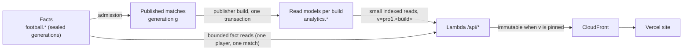

# Precomputed season read models — design for approval (5 Nov 2026)

Status: **proposal, nothing implemented**. Approval is required before migration
018 (indexes only), the publisher change and any RDS write.

## 1. Why

The site's pages (overview, competitions, clubs, players, archives, match tabs) are a
"fat client": the browser downloads every appearance of a league-season and
computes averages, per-90, leaderboards, centiles, similarity and standings itself.
On AWS the only source for that is `/api/seasons/partition`, which rebuilds and
re-validates the whole season on every request. Measured on RDS (Ligue 1 2025/26,
12,200 performances, 378,200 metric values, t4g.micro): **35.6 s per request**, about
10 s per 100-match page after optimisation, against an 8 s statement limit. It also
breaks on real data because admission re-revised participants and sides without
re-anchoring facts. Details: `docs/verification/orion-pro-frontend-port-20261105/FINDINGS.md`.

**Principle: compute once at publication, read small at request time.** Every
published build gets its aggregates written in the same transaction as its
summaries. They are immutable and identified by the build's version token. A page
request becomes an indexed read of tens to a few hundred rows.

## 2. Read models — existing approved tables, no new table

All six tables below are already in the approved core model (`phase=core`), keyed
by `build_id`, and currently empty. The publisher fills them; no table or column
is added.

| Table | Grain | Computed from (selected at the build's dataset generation) | Serves |
|---|---|---|---|
| `analytics.match_summary` (already filled) | build × match | matches, sides, scores | fixtures, results, calendar, match header |
| `analytics.competition_summary` (already filled) | build | match_summary | competition cards, progress |
| `analytics.team_competition_stats` | build × team | finished matches, final score scope | standings table (`points_calculated`, labelled calculated), club cards |
| `analytics.player_competition_team_stats` | build × player × team | `player_match_stats` (full_match) + participants | squads, player season header, directory rows |
| `analytics.player_competition_stats` | build × player | sum of the player × team rows | leaderboards, directory, player history |
| `analytics.metric_totals` | build × {player, player_team, team, competition} × metric | the 31 native metric values | per-90, centiles, similarity, club style cohorts, any-metric leaderboards |
| `analytics.player_search` | player (global) | current profiles, aliases | navbar search |

Rules that keep the aggregates truthful:

- **Missing is not zero.** `metric_totals` sums only observed numeric values and
  stores `observed_count`, `eligible_count`, `eligible_minutes` and `coverage_state`.
  A metric never observed for a player has no total, not 0. Per-90 values are computed
  at read time from the stored numerator and minutes, and the denominators are returned.
- **Logical joins.** Participants and sides are resolved by logical identity at the
  build's generation, not by the facts' original revision ids. This removes the anchor
  drift that broke the current readers.
- **Same build, same transaction.** The aggregates are written before the build turns
  READY. The existing deferred READY trigger and publication pointer swap stay as they
  are. Activation remains atomic per edition.
- **Contract.** Representation stays `summary-v1-shots-v1`, so current readers keep
  working. New builds carry `metrics_contract_version = orion_pro_season_aggregates_v1`;
  the new routes require it.

Size estimate per edition (around 600 players, 18–20 teams): about 39k `metric_totals`
rows plus about 1.3k player rows. For the full target (73 leagues × 6 seasons ≈ 438
editions): about 17 M rows, roughly 3–4 GB with indexes, inside the 64 GiB RDS. Build
cost: a few seconds of `INSERT … SELECT` per edition.

## 3. Schema change requested: migration 018, indexes only

| Index | Used by |
|---|---|
| `metric_totals (build_id, subject_kind, metric_code, numeric_value DESC)` | any-metric leaderboards |
| `metric_totals (build_id, subject_kind, player_id)` | one player's vector, cohorts |
| `metric_totals (build_id, subject_kind, team_id)` | club style, squad metrics |
| `player_competition_team_stats (build_id, team_id)` | squads |
| `player_competition_team_stats (player_id)` | player history across editions |
| `player_competition_stats (player_id)` | player history, search ranking |

The model already has `player_competition_stats (build_id, goals, player_id)`. No
constraint, grant, table or column changes. Adoption follows the 016/017 pattern
(owned proof, read-only preflight, atomic apply, independent readback).

## 4. API routes (new)

Every route takes `v=pro1.<build>.<digest>`. Each one is GET/HEAD, serves ETag and 304,
and is cached by CloudFront (immutable when `v` is pinned). Targets per request: at most
3 SQL statements, no more than 300 ms of database time on the t4g.micro, no more than
150 KB gzipped.

| Route | Rows | Replaces client work in |
|---|---|---|
| `/api/editions/{league}/{season}/table` | ≤ 24 teams | `competition-standings`, `standings-clubs`, club rank cards |
| `/api/editions/{league}/{season}/players?metric&order&per90&minMinutes&position&cursor&limit` | ≤ 50 per page | `player-leaderboard`, `player-directory`, `season-player.aggregateSeasonPlayers` |
| `/api/editions/{league}/{season}/cohort?metrics=…` (≤ 12 metrics) | eligible players only | centiles and similarity (`createSeasonPeerBuilder`, `clubCentile`, `similarClubs`) |
| `/api/editions/{league}/{season}/teams/{team}` | squad + team totals | `club-roster`, `club-analysis.clubSummary`, `clubSquad` |
| `/api/players/{player}/seasons` | one row per published edition | `player-season-history`, `scouting-history`, `loadPlayerHistory` |
| `/api/players/{player}/matches?league&season` | ≤ 60 matches (facts, bounded) | season match list on the player page |
| `/api/home` | results/upcoming per league, top N per metric, league progress | `home-insights` (match of the week, leaders, progress) |
| `/api/search?q` | ≤ 20 | navbar search (`global-search`) |

The existing match routes (`/api/fixtures`, `/api/matches/{id}/summary`, shots,
statistics, details) stay. Their fact readers get the same logical-join fix
(competitions, archives, entities, match statistics, match details, spatial).

## 5. Frontend changes

| Page | Today (Neon) | After |
|---|---|---|
| `/` Vue d'ensemble | all appearances of focus leagues → client insights | `/api/home` |
| `/joueurs` directory, leaderboards | all appearances → `aggregateSeasonPlayers` | `/players` pages + `/cohort` for centiles |
| player profile | season appearances + routing history | `/players/{id}/matches` + `/players/{id}/seasons` |
| `/clubs` and club page | season appearances + fixtures | `/teams/{team}` + `/table` + `/api/fixtures` |
| `/competitions` | season model + support helpers | `/table` + `/players` + match_summary fixtures |
| `/matchs`, match page | already on AWS | unchanged; tabs keep their own routes |
| `/classement-joueurs` (Ballon d'Or) | not computed today (`ballonDorRanking` returns null) | unchanged, out of scope |
| `/archives`, cups, rankings, enrichment | legacy helpers | their existing readers after the logical-join fix and the data import |

`FootballContext` stops downloading seasons in Pro mode. Pages request what they
display, and the `/matchs`-only gate is removed page by page as each one passes parity.

## 6. Verification

1. Owned end-to-end runs, written before code: the publisher fills the six tables.
   An independent SQL recomputation from facts must match exactly, including
   null/absent/zero cases, multi-team players, corrections at a later generation and
   immutable READY rows.
2. Real RDS: republish Ligue 1. Measure every route (SQL count, database ms, bytes,
   CloudFront hit/304).
3. Parity: for Ligue 1 2025/26, compare every number on each page, computed from the
   legacy Neon season against the new routes. List any difference explicitly.
4. Desktop and mobile browser checks of each page before its gate is removed.

## 7. Order of work

1. Your approval of this design.
2. Migration 018 (indexes): owned proof, then RDS adoption.
3. Publisher extension and owned end-to-end runs.
4. On RDS: write the prepared performance-coverage generation, then republish Ligue 1
   (new builds with aggregates).
5. Routes and their tests, then the logical-join fix in the remaining fact readers.
6. Frontend pages one by one, local parity, then the Vercel preview.
7. Import all leagues through the same pipeline (step 3 of your order).
8. Cutover: point Vercel at the AWS API, then remove the Neon runtime code.

## 8. Decisions requested

- Use the six existing approved aggregate tables as the per-build read models, with the
  grains and truthfulness rules above.
- Metrics contract `orion_pro_season_aggregates_v1` for new builds (representation
  unchanged).
- Migration 018 with the six indexes above, and nothing else.
- The new routes listed in section 4.
- The prepared performance-coverage write (387 rows, plan verified).
- Out of scope: Ballon d'Or scoring (the model tables stay deferred), native detail
  families pending 107, and observed standings (calculated standings are labelled as
  calculated).
