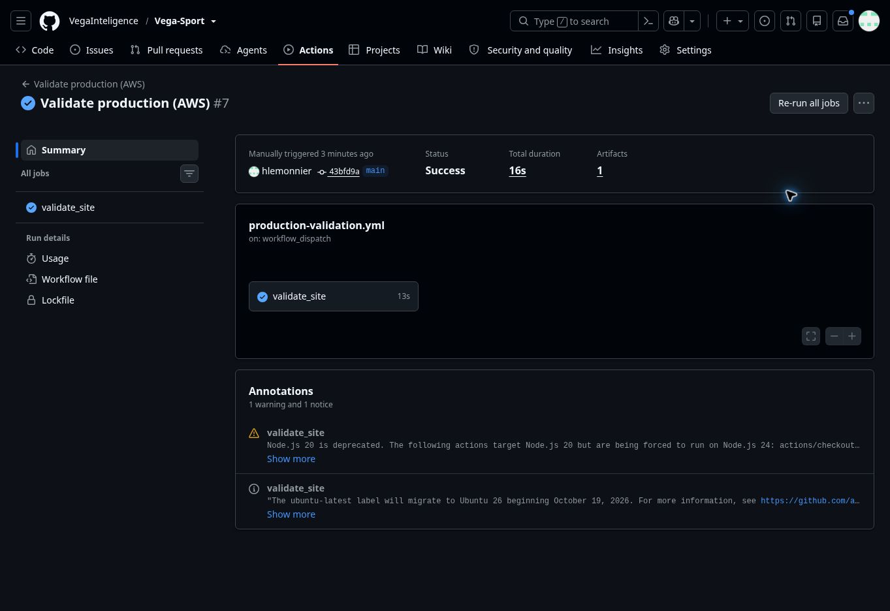

# Database refactor — release and operational acceptance

## Status: production refactor accepted; bounded adapted publisher completed successfully

The production cutover committed at **08:05:32.376513 UTC on 7 November 2026**, after exact verification of **7,838,886 rows across all 112 mapped kinds** and **207,790 reconstructed resources**. Production is in active mode at revision **8838**, with **56 physical app tables** and all **112 former provider tables retained for reversal**. The actual runtime account and all migrated relation/function contracts passed after activation. The [production acceptance record](PRODUCTION_CUTOVER_20261107.md) and [native clone roundtrip](NATIVE_ROUNDTRIP_20261107.md) contain the full evidence. The final navigation, adapted publisher, private evidence preservation and temporary-resource cleanup gates are accepted below. Normal source backlog remains for bounded continuation.

[PR #28](https://github.com/VegaInteligence/Vega-Sport/pull/28) is merged into main at [`4268b3291f9a3850624196fecf9608e0652531e5`](https://github.com/VegaInteligence/Vega-Sport/commit/4268b3291f9a3850624196fecf9608e0652531e5). The main [Verify ingestion run 42339228640](https://github.com/VegaInteligence/Vega-Sport/actions/runs/42339228640) completed successfully, as did [Validate production (AWS)](https://github.com/VegaInteligence/Vega-Sport/actions/runs/42339228162). Those are the initial application release checks; the subsequent navigation releases and final production acceptance are recorded separately below.

[PR #29](https://github.com/VegaInteligence/Vega-Sport/pull/29) completed the remaining navigation corrections and enabled direct browser reads from the existing public API in production. Its PR and main CI runs passed all three jobs. [PR #30](https://github.com/VegaInteligence/Vega-Sport/pull/30) added bounded browser request admission and safe throttle retries. The post-cutover browser check then found an image regression: Blob fetching added a CORS requirement that the final media CDN response did not satisfy. That failed image gate remains in the evidence.

[PR #31](https://github.com/VegaInteligence/Vega-Sport/pull/31) fixes image loading using native images under the same shared admission queue. Its [PR CI](https://github.com/VegaInteligence/Vega-Sport/actions/runs/42355898799) passed all three jobs, including the complete 126-test navigation command. Main commit `3ce123f44bd359f59e5c38e30d5149b82c085603` is deployed to [the production frontend](https://vegasport.vercel.app) as `dpl_2tjAdv7MksrUtz6wLgd6YoQdkSjr`, verified READY with the production alias at **08:40:13.905 UTC**. All 11 final recorded UI actions passed, including actual decoded native portraits and crests. See the [browser acceptance](FRONTEND_UI_ACCEPTANCE_20261107.md).

[PR #32](https://github.com/VegaInteligence/Vega-Sport/pull/32) merged bounded hourly continuation and fair service for the serving queues at main `43bfd9a5ec294fe78c3497b57c38b4ae0e305991`. Its [PR CI](https://github.com/VegaInteligence/Vega-Sport/actions/runs/42357792435) and [main CI](https://github.com/VegaInteligence/Vega-Sport/actions/runs/42358325301) each passed all three jobs. The serving workflow is enabled. It uses a 30-minute admission budget each hour, with shared writer exclusion, small atomic catalogue batches and failure isolation; see the [operating contract](PUBLICATION_CONTINUATION_20261107.md). The historical source collector was not enabled as part of this continuation change.

The production frontend for this revision, `dpl_7zXTK2buQAxWa5UuauZqLzR5EkAP`, was verified READY with the production alias. Its frontend source tree is identical to the accepted PR #31 tree (`30ad312804d21db83475deae5abd04faa45c3630`). An independent [production validation run](https://github.com/VegaInteligence/Vega-Sport/actions/runs/42358474605) on this exact main revision passed all 13 API checks and five page-shell routes.

The backend deployment was verified at **07:53:44.005427 UTC**, with CloudFormation `UPDATE_COMPLETE` and Lambda `Active` / `Successful`. It enables the player aggregate reader and `Server-Timing`, and exposes retry metadata to the direct browser client. Its artifact SHA-256 is:

```text
5f4de1d2d69b11a2f80710ae277df8aab66b9be5ee02ea2ddd5899553b50a261
```

Deployment identity is recorded in `native-image-production-ready.json`, `backend-throttle-deployment-status-01.json` and `backend-throttle-cors-live-get.json`. The earlier deployment and pre-cutover HTTP receipts remain historical observations; they are not substituted for final acceptance.

## What the database change actually simplifies

The implemented target reduces the **active physical publication schema, `statarena_app`, from 161 to 56 tables after verified activation**. It replaces 112 provider-shaped detail tables with three constrained, indexed stores: `catalog_records`, `support_records` and `detail_records`. Canonical identities, fixtures, matches, appearances, shots, compact metrics and provenance headers retain their indexed relational contracts.

The exact [112-family mapping](../../dashboard/scripts/consolidation-manifest.json), [shared model](../../dashboard/scripts/consolidated_model.py) and [cutover/rollback runbook](../../dashboard/scripts/DB_REFACTOR_OPERATIONS.md) define the transformation. The [schema plan](../../dashboard/scripts/SCHEMA_CONSOLIDATION_PLAN.md) distinguishes this implementation from the earlier conditional whole-database design.

| Group | Disposition |
| --- | --- |
| Active publication model | Observed **56 physical tables**: 49 retained tables, three record stores, one consolidation-state table, one player aggregate and two archive projections. |
| Former provider detail tables | **112 physical tables retained for rollback**, moved to `statarena_retired_v1` at activation; compatibility views preserve the old read contracts. |
| Old transfer captures | **10 tables archived into `statarena_legacy_transfer`**, preserving **353,127 rows**. Both owner receipts match the final union proof. |
| Historical Pro model | **98 tables preserved** across `football`, `ingest` and `analytics`; optional historical contracts remain separate from current public serving. |
| Authentication | **9 tables preserved** and excluded from sports-data consolidation. |

The 161→56 comparison is therefore an active-schema result. It is **not a reduction of the entire database to 56 tables or a claim of reclaimed storage**. The 112 rollback tables remain physical data, the ten transfer tables were moved rather than deleted, and backfill temporarily duplicates mapped records. No source-table deletion is part of this release. Any eventual physical retirement requires its own exact-manifest decision after the recovery window.

Transfer execution is evidenced by `production-transfer-union-proof.json` (`tableCount=10`, `rowCount=353127`, `afterMatchesBothArchivalReceipts=true`); the [transfer audit and procedure](LEGACY_TRANSFER_ARCHIVE_20261107.md) explain why these captures were eligible for archival.

## Read models, freshness and navigation already accepted

At cutover, the player-directory aggregate was ready in **all 100 published partitions**, with **0 stale** and **0 ambiguous** partitions (`production-active-rollup-readiness.json`). The later publisher-progress observation below records 118 fresh partitions after additional publication. Aggregate refresh belongs to the same transaction as publication, so a page cannot silently combine a new generation with an old aggregate.

All **154 historical archive editions** are ready, containing **507,698 merged match rows** and **461,696 recorded goal events**, with no missing or stale projection. Per-edition receipts preserve the canonical source fence and unchanged consolidation control. The exact results/goals merger now runs at publication time; public reads retrieve a bounded page or one selected match's goals. Complete totals and competition facets remain independent of the visible page. See the [archive backfill and acceptance record](ARCHIVE_READ_PROJECTION_20261107.md); its canonical completion receipt is `prod-archive-backfill-summary.json`.

Route-specific loading, deferred actor/match detail and publication-bound caches extend beyond the main dashboard. The deployed [browser acceptance](FRONTEND_UI_ACCEPTANCE_20261107.md) exercised player pagination/search/profile, club filtering/profile, match overview and shots, competition standings/matchdays, calendar and archive pagination/search/detail. The weekly widget displays **2–8 November 2026** with `asOfDay=2026-11-07`; the HTTP check verified that its selected performance belongs to the period. The UI displayed Anastasios Douvikas instead of the formerly stale Hakimi selection. These observations establish the tested current-period behavior, not independent verification of upstream football results.

## Deployed HTTP evidence before cutover

The [complete public receipt](../verification/db-refactor-20261107/runtime-before-cutover.json) preserves **all 30 requests**, response sizes, cache outcomes, exact timings and assertions. It reports `passed=true` and `fullyExercised=true` across **nine page/action groups**. The requests ran from **05:25:36.736 to 05:26:24.070 UTC**, against source generation **293**, while production copy was active on the existing `db.t4g.micro` instance.

Selected raw observations are shown below. SQL and origin values are the response's `Server-Timing` measurements; client elapsed includes the session proxy, connection and startup/transport overhead. All values are milliseconds.

| Receipt request label | Cache | SQL | Origin | Client elapsed |
| --- | --- | ---: | ---: | ---: |
| `players-default-all` — 20 players, all leagues | MISS | 405.99 | 467.30 | 5228.348 |
| `players-page-2` | MISS | 318.60 | 323.12 | 8023.530 |
| `players-default-repeat` | HIT | — | — | 63.029 |
| `player-summary` | MISS | 179.00 | 185.14 | 4805.502 |
| `search-name` | MISS | 96.09 | 97.72 | 273.302 |
| `search-broad` | MISS | 130.72 | 132.35 | 5465.512 |
| `search-broad-repeat` | HIT | — | — | 4986.962 |
| `clubs` | MISS | 279.70 | 281.67 | 460.061 |
| `club-summary` | MISS | 177.84 | 182.21 | 407.314 |
| `competition-standings` | MISS | 91.93 | 94.17 | 268.337 |
| `calendar-day` | MISS | 30.42 | 31.68 | 256.127 |
| `home-current-week` | MISS | 1133.71 | 1152.13 | 1445.492 |
| `match-summary` | MISS | 105.04 | 106.73 | 284.542 |
| `archive-first-page` — 2020/2021 | MISS | 119.64 | 121.33 | 296.585 |
| `archive-second-page` — 2020/2021 | MISS | 7.80 | 8.92 | 89.025 |
| `archive-match-goals` — one selected match | MISS | 14.20 | 15.07 | 200.981 |

Conditional player and archive requests returned 304 in **8.646 ms** and **11.259 ms** of client elapsed respectively. Cache hits have no new origin timing in this receipt; an old cached origin header must not be interpreted as fresh database work.

These sequential checks are not a load test, controlled physical-cold-cache benchmark or percentile estimate. Several client requests still took roughly five to eight seconds, including a **4,986.962 ms CDN hit**. That residual delay cannot be assigned to SQL from this evidence, and it prevents a blanket claim that every end-to-end navigation is already instantaneous. The complete slower observations are retained in the public receipt. Browser-tool round-trip duration is also not used as a frontend latency measurement.

## Final live acceptance with the consolidated database active

The [complete final HTTP receipt](../verification/db-refactor-20261107/runtime-after-cutover.json) records **30 successful requests across all nine page/action groups**, with no unexercised group. It ran from **08:44:30.974 to 08:45:36.721 UTC**, against publication generation **310**, while the normal production publisher continued. A separate [13-request runtime check](../verification/db-refactor-20261107/compact-runtime-after-cutover.json) passed all seven advertised compact-read kinds with no unexercised contract.

The final [UI acceptance](FRONTEND_UI_ACCEPTANCE_20261107.md) passed all **11 recorded actions** on the PR #31 production deployment. It covered actual decoded native portraits/crests, player search/profile, club pagination/profile, archive pagination and goal detail, match overview/shots and return navigation. The return page had **18/18 inspected visible images decoded**. The [capacity observation](../verification/db-refactor-20261107/navigation-capacity-after-cutover.json) contains all relevant timing scope and source hashes: **134 Lambda invocations**, **0 errors**, **0 throttles**, and **peak concurrency 3** in the matching three one-minute bins. Other production traffic may share those bins; CDN hits do not invoke Lambda. This is a bounded acceptance window, not a load test or a browser page-latency measurement.

Selected final request observations are shown below. Origin/SQL timings from `RefreshHit` or `Hit` responses are stored headers and are deliberately omitted from this comparison.

| Request | Cache outcome | Current SQL ms | Current origin ms | Client elapsed ms |
| --- | --- | ---: | ---: | ---: |
| All-league player page, 20 rows | MISS | 797.22 | 911.14 | 5993.383 |
| Same player page repeat | HIT | — | — | 62.611 |
| Player page two | MISS | 413.06 | 417.97 | 9691.367 |
| Player summary | MISS | 227.72 | 234.45 | 5164.898 |
| Exact name search | MISS | 129.39 | 131.27 | 317.572 |
| Broad two-character search | MISS | 176.13 | 177.90 | 7888.550 |
| Same broad search repeat | HIT | — | — | 6450.698 |
| Club directory | MISS | 156.73 | 157.91 | 3875.333 |
| Club summary | MISS | 134.98 | 139.48 | 1229.213 |
| Recent competition fixtures | MISS | 18.77 | 20.56 | 701.061 |
| Fixture cursor continuation | MISS | 8.02 | 9.50 | 317.748 |
| Calendar day | MISS | 11.42 | 13.15 | 1225.019 |
| Current-week home | MISS | 1787.11 | 1797.49 | 2097.984 |
| Archive page two | RefreshHit | — | — | 255.318 |
| Selected archive goal detail | RefreshHit | — | — | 147.401 |

The player and archive conditional reads returned **304** in **8.272 ms** and **9.818 ms**. Source sizes remain bounded; the player page was 77,088 decoded bytes, the broad search 2,231 bytes, and the first archive page 20,275 bytes. No player page loaded a full season, and archive listings did not load goal arrays.

The residual multi-second client observations remain visible, including a **6,450.698 ms CDN hit** and a health request with **2.73 ms of origin processing** but **5,530.537 ms client elapsed**. These receipts do not identify that residual transport cause. Four existing project-level LCP observations in the UI window were 300–468 ms, but there was only one sample per route; LCP also does not measure completion of asynchronous page/search data. Neither the sparse RUM observations nor the function timings justify a claim that every page is instant for every user.

### Independent production network check

The [independent runtime receipt](../verification/db-refactor-20261107/independent-production-runtime.json) was captured by the GitHub runner at **10:09:02.817 Paris time (09:09:02.817 UTC)**. It reached the deployed public Vercel API relay and passed all 13 requests; five page shells also returned HTTP 200 HTML. All seven compact-read kinds were exercised. The [validation record](../verification/db-refactor-20261107/independent-production-validation.json) binds the run and exact commit.

| Independent runner request | Client elapsed ms |
| --- | ---: |
| Initial health | 1043 |
| Manifest | 280 |
| Current-season bounded partition | 675 |
| Previous-season bounded partition | 239 |
| Scoped home | 439 |
| Scoped player page | 234 |
| Conditional player page, HTTP 304 | 82 |
| Player page two | 186 |
| Scoped club directory | 126 |
| Player profile | 214 |
| Performance detail | 157 |
| Discipline | 205 |
| Club profile | 133 |

These are individual samples, with a single-league scope and smaller pages than the all-league local sweep. They provide an independent successful network check; they are not a controlled comparison, search measurement, browser-ready metric or latency percentile. The earlier multi-second local transport observations remain in the full receipt.



### Native state after further publication

The [read-only checks](../verification/db-refactor-20261107/native-post-publication-read.json) at **10:16–10:17 Paris time (09:16–09:17 UTC)** confirmed active mode at revision **8838**, **56 app tables**, **112 retained provider tables**, and **302 durable physical tables**. The running publisher also had eleven session-temporary staging tables; those are not additional persistent architecture.

Publication had advanced to generation **324** and the queued partition count had fallen **390 → 362**. All **128 published player-rollup scopes were fresh**, with zero stale/ambiguous scopes, and all **154 archive editions were ready**. These are time-stamped progress observations while the publisher was running.

The actual runtime role could still read its latest eligible lineup sample (status **200**, **41 members**), catalogue-status scalar (**null**), honours and rollups. This query selects the latest eligible resource ID; it does not return a stable match identity. The new 41-member observation is therefore an availability check and cannot be treated as a same-source comparison with the 40-member cutover sample. The exact before/after cutover contract comparison remains separately preserved.

## Publication capacity decision

The [capacity review](../verification/db-refactor-20261107/publication-capacity.json) found no unconditional rewrite of identical source responses and no missing normal-publication capacity check at the commit boundary. Current capacity and limits are retained. The application checks the **whole database** against a **52,000,000,000-byte ceiling with a 2 GiB reserve**, giving an admission threshold of **49,852,516,352 bytes (46.43 GiB)**, and checks actual size again before committing publication work.

The active schema grew by **5.77 GiB** while **28 additional scopes** were published. Identical responses are skipped; changed families replace their complete descendant records. The available totals cannot separate new live data from replaced versions, indexes or reusable storage, so they do not establish a bloat estimate or capacity for the entire remaining backlog. These transactional admission checks are not a filesystem quota or a guarantee of immediate physical space reclamation. No instance resize, capacity-limit increase or source-queue restart was performed.

## Completed adapted publisher

The [original production run 42354243225](https://github.com/VegaInteligence/Vega-Sport/actions/runs/42354243225) completed successfully. Its final structured receipt at **10:51:01.609 Paris time (09:51:01.609 UTC)** reports **45 committed partitions**, **zero failed/deferred partitions**, and **160 catalogue inputs**. The 45 matching committed-partition log entries total **12,117 normalized matches**; all four catalogue-batch entries reconcile to the same 160 inputs. There were no deferred-phase or traceback entries in the completed log.

The [public completion receipt](../verification/db-refactor-20261107/publisher-completed.json) preserves these counters and every job-step conclusion. The publication receipt upload and the credential action's post-cleanup step succeeded. The log reports removal of its one temporary runner ingress rule at **09:51:05.493 UTC**. The optional lineup-reader switch was correctly skipped because the authorized input was `unchanged`.

The final **35,690 remaining work items** combine partition and catalogue jobs; this is not a count of partitions alone. Successful completion means the bounded run finished and committed its work, not that the source backlog drained. This run checked out `a34514589726d6f8770dbcb86a798bd76d6b0af7`; the enabled hourly continuation and fairer queue service merged in PR #32 apply to subsequent runs. No first scheduled-run success is inferred from the schedule definition.

This final outcome was observed after the two evidence archives were sealed. Its sanitized receipt is preserved separately in Git, byte-identical to the canonical operator receipt, SHA-256 `04b6da65b368c2d799b85fce425dd5a30e877ad1b40f8833e3b871518e64d5b0`.

## Native completion and operational acceptance

An encrypted PostgreSQL 18.6 pre-cutover snapshot was recorded as `available` (`production-pre-cutover-snapshot.json`). The complete clone roundtrip independently demonstrated reversal after new consolidated writes. The clone was restored from the earlier 01:35 snapshot; the separately retained 04:15 snapshot is the newer production recovery point. After publication advances, recovery requires reverse copying the current consolidated data before switching back to the legacy writer.

| Required evidence | Status and fields to complete |
| --- | --- |
| Full production forward copy and exact parity | **ACCEPTED** — all **7,838,886 rows across 112 kinds** copied and exactly verified at revision **8838**, plus exact reconstruction of **207,790 resources**: 944 catalogue, 1,989 support and 204,857 detail resources. Canonical final gate: `production-resource-status-010.json`, independently reviewed before activation. |
| Native three-store publication and reverse-copy proof | **ACCEPTED** — full clone forward copy/row proof: **6,213,334 rows / 112 kinds**; exact reconstruction of **167,273 resources**; activation into **56 physical app tables**; four new records published across the three stores; reverse copy/exact proof of **6,213,338 rows**; guarded rollback; native legacy continuation; actual runtime reads in all three phases. Final clone: legacy, revision **4883**, generation **203**, writes disabled. See `clone-native-closeout-accepted.json`. Native SQL continuation and the CI Python-writer fixture are distinct checks. |
| Production activation | **ACCEPTED** — committed **08:05:32.376513 UTC**, active mode, revision **8838**, publication generation **293 → 294**; activation SQL 862 ms, worker total 942 ms. Receipt: `production-native-activation.json`. |
| Final schema and runtime proof | **ACCEPTED** — **56 app / 112 retained physical tables**; exact contracts for **112 compatibility views and 62 row-type functions**, with zero contract issues and no public app view bound to retired physical tables. Actual runtime reads equal the baseline. At cutover, all **100 player rollups** and **154 archive editions** were fresh/ready; later observations above show 128 fresh rollup scopes. The persistent database contains **302 durable physical tables**; active session-temporary staging tables are excluded. See the [public native receipt](../verification/db-refactor-20261107/native-production-cutover.json). |
| Post-cutover HTTP and UI acceptance | **ACCEPTED** — 30 HTTP requests across all nine groups at generation **310**, 13 compact-runtime requests, and all 11 final UI actions on main `3ce123f4`, including 18/18 decoded visible images on return. Matching function metrics: 134 invocations, zero errors/throttles, peak concurrency three. The complete timings and their limitations are preserved above. |
| Adapted production publisher | **ACCEPTED** — [run 42354243225](https://github.com/VegaInteligence/Vega-Sport/actions/runs/42354243225) completed successfully after its 100-minute admission budget: **45 partitions**, **12,117 normalized matches**, **160 catalogue inputs**, **zero failed/deferred partitions**. Final counters and log totals reconcile. The job uploaded its receipt and removed its temporary runner ingress rule. **35,690 combined partition/catalogue work items remain** for continuation; the backlog is not declared empty. See the [completion receipt](../verification/db-refactor-20261107/publisher-completed.json). |
| Durable native DB/recovery evidence bundle | **ACCEPTED** — 477 files, **11,778,758 ZIP bytes**, private AES256 object, manifest verified locally, S3 checksum/length checked, then full-byte readback verified at **08:40:56.968808 UTC**. SHA-256 `a7e8dfe645887731e4243d5e40df40ecfe411729a1adad55218100687a75897f`. See the [public preservation receipt](../verification/db-refactor-20261107/native-proof-preservation.json). Final publisher/HTTP/UI and cleanup evidence belongs to a later operational supplement. |
| Durable operational evidence supplement | **ACCEPTED** — 63 reviewed source files, **443,736 ZIP bytes**, private AES256 object; local manifest, S3 checksum/length and full-byte readback verified at **09:45:31.807516 UTC**. SHA-256 `86d241597b6ece1bf4de12bcbde3acacfb915d7e8b6d620ad1bd918db51d7204`. See the [operational preservation receipt](../verification/db-refactor-20261107/operational-proof-preservation.json). Scope covers the fixed final UI/HTTP, native progress, capacity, deployment and migration-cleanup observations; the subsequently completed publisher is recorded separately in Git. |
| Operational cleanup and recovery retention | **ACCEPTED** — all three temporary stage/ingest/read-validation worker stacks and the final worker’s Lambda, IAM role and log group were confirmed `DELETE_COMPLETE` at **09:38:11.455250 UTC**. The disposable validation clone is absent. The production database remains available and encrypted, the backend remains active/successful, and both encrypted recovery snapshots remain available. All 112 retired provider tables, ten archived transfer tables and release artifacts are retained. See the [cleanup receipt](../verification/db-refactor-20261107/cleanup-accepted.json). The subsequently completed publisher separately reported removal of its own temporary runner ingress rule; its post-cleanup step succeeded. |

Canonical receipt filenames identify the operator's evidence. The primary private bundle digest above binds the preserved native database/recovery subset and its fixed observations. The separate, verified operational supplement binds its 63 enumerated final HTTP/UI, deployment, capacity, native-progress and migration-cleanup files. Publisher progress in that archive is a time-stamped observation; the later successful final workflow outcome is recorded separately in the Git-backed completion receipt. Neither archive includes credentials or infrastructure invocation/configuration artifacts. This release record remains versioned in Git and is excluded from the archives that it identifies.
